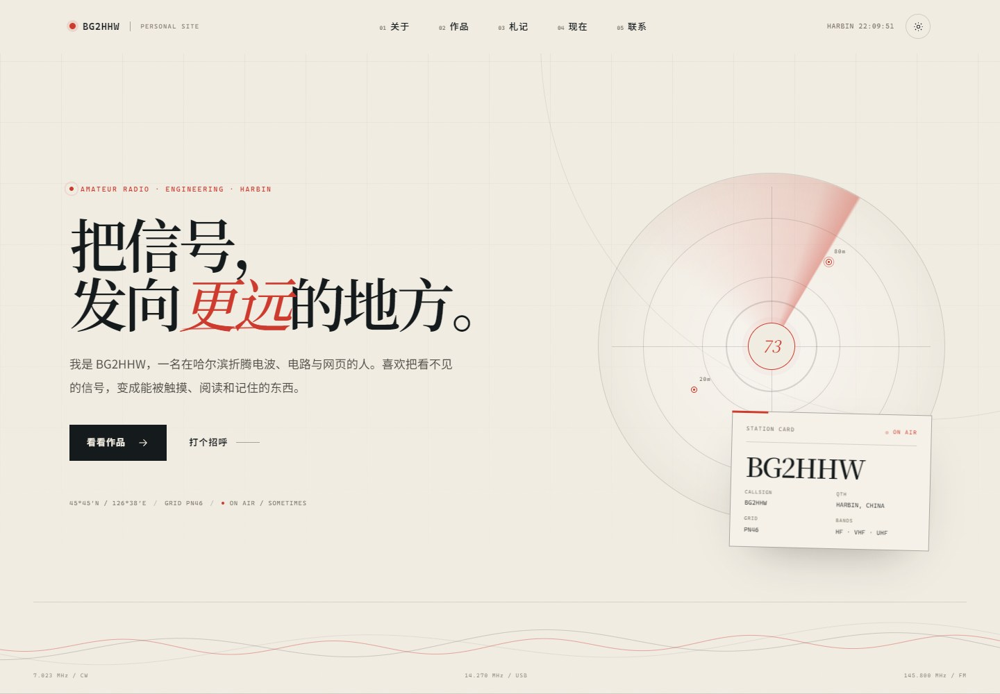
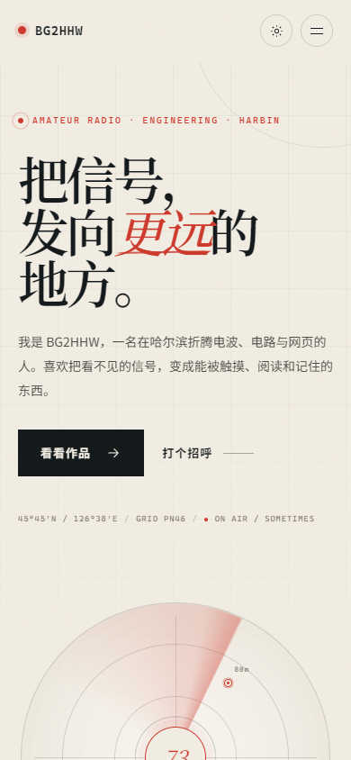

# BG2HHW · 个人主页

一个无需构建、直接打开就能看的单页个人主页。主题是业余无线电、工程实践、印刷设计与前端开发。

当前内容根据工作区里的呼号、QSL 设计与社团项目整理。姓名、邮箱、头像等个人信息还可以继续替换成你的真实版本。





## 预览

直接双击 `index.html`，或在目录里开一个本地服务器：

```powershell
python -m http.server 8080
```

然后访问 `http://localhost:8080`。

## 修改内容

所有文字、项目、链接都在 `js/content.js` 里：

- 个人介绍与首屏文案：`identity`
- 关于与坐标信息：`about`
- 项目列表：`work.projects`
- 札记列表与 QSL 入口：`log`
- 正在做的事：`now.cards`
- 联系方式：`contact.links`

项目卡片支持四种视觉：`image`、`ui`、`drone`、`poster`。要换图片，把图片放进 `assets/`，再改项目里的 `image` 路径。

QSL 项目带有可点击的图片画廊，图片列表在项目的 `gallery` 字段里；按键盘方向键可以切换。

## 可以继续补充

- 换成自己的项目截图或照片
- 增加简历 PDF 下载
- 接入表单服务（Formspree、Cloudflare Workers 等）
- 部署到 GitHub Pages / Vercel / Cloudflare Pages

## 域名上线

当前站点已按 `https://bg2hhw.top/` 配好 `CNAME`、canonical、`og:url`、`og:image`、`robots.txt` 和 `sitemap.xml`。

部署时把仓库推送到 GitHub，在仓库 **Settings → Pages** 选择 `Deploy from a branch`、`main`、`/ (root)`，再填写自定义域名 `bg2hhw.top`。域名 DNS 交给 Cloudflare 管理，A 记录使用 GitHub Pages 官方地址，详见项目聊天记录中的部署步骤。

## 文件

```text
index.html       页面结构
css/styles.css   全部样式、深色模式与响应式
js/content.js    内容配置
js/main.js       渲染、主题、动效与交互
assets/          图片与图标
```

站点没有外部依赖，断网也能正常显示。深色模式会跟随系统，也可以手动切换并记住选择。
